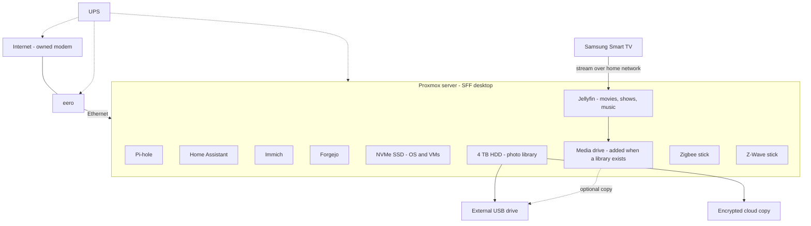
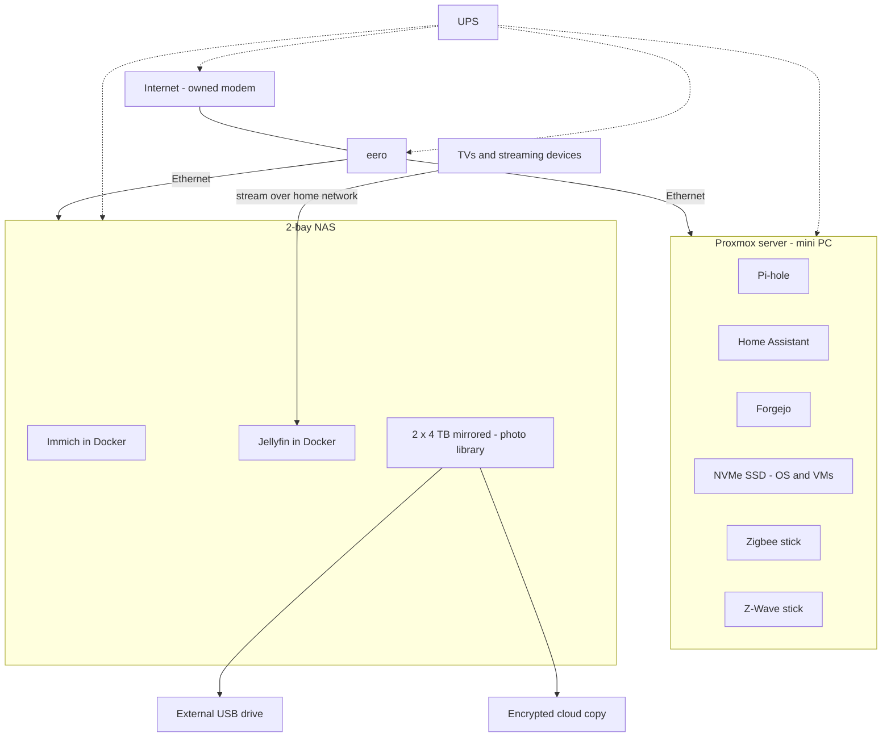

# Architecture

Last updated: 2026-11-25 (Option A decided, Jellyfin chosen for media, Samsung TV and streaming notes added)

This is the design reference to check before spending any money. Each decision is recorded with the choice, the reasons, the cost if it turns out wrong, and what would change it. Update it whenever a decision changes.

## Goals and constraints

- Local first, with no outside access. No port forwarding, no remote-access tools.
- Replace Google Photos. About 1 TB of photos and videos today.
- Run Pi-hole, Home Assistant, Immich, Forgejo and Jellyfin (movies, shows, music and other media).
- Devices: Zigbee and Z-Wave sensors, plus two displays (one for control, one for information).
- Budget ceiling: $1,200.
- Network: a rented eero, connected to an owned modem.
- Beginner skill level, so favour simple and recoverable over clever.
- You will experiment on this system, and the photos are irreplaceable. Keep those two facts in mind for every decision.

## The big question: where do the photos live?

There are three realistic layouts. This is the most expensive decision to get wrong, so it comes first.

### Option A: one box (photos on the server) - chosen

One Proxmox server runs everything. The photo library sits on a 4 TB hard drive inside it.

### Option B: server plus a separate NAS - not chosen for now

A small Proxmox box runs the services. A 2-bay NAS holds the photos on two mirrored drives. Immich runs either on the NAS (in Docker) or on the server with the library on the NAS.

### Option C: server with a USB drive for photos

Rejected. USB drives can sleep or disconnect, and passing them to a VM adds fragile steps. Not worth saving a few dollars.

### Comparison

| | Option A: one box | Option B: server plus NAS |
|---|---|---|
| Rough cost | about $680 to $1,135 | about $925 to $1,545 |
| Fits the $1,200 ceiling? | Yes, with room | Only with lean choices. The top end does not fit |
| Boxes to run and learn | One | Two |
| Photos survive a server experiment gone wrong | Only through backups | Yes. The NAS is separate from the experiments |
| Drive failure | Restore from backup. Downtime until restored | A mirror keeps running. Backups still needed |
| Power use | One machine, lower | Two machines, higher |
| Immich first import | Faster, with a desktop CPU | Slower on a NAS CPU, but it works CPU-only |
| Upgrade path | Add a NAS later | Add a bigger NAS or more bays later |
| Biggest risk | One box holds everything | Cost and complexity |

Cost notes: Option A is the server ($250 to $400), a photo drive ($90 to $120), a backup drive ($90 to $110), a UPS ($70 to $120), radio sticks and cables ($80 to $135) and displays ($100 to $250). Option B swaps the server for a smaller one ($150 to $300) and adds a 2-bay NAS ($255 to $390 diskless), a second photo drive and a bigger UPS. Retail reviews in autumn 2026 put 2-bay NAS boxes in that range, with the UGREEN DXP2800 listing near $390 but often selling for less. Prices move, so confirm before buying.

### Recommendation

Start with **Option A**, and design it so a NAS can be added later:

- It fits your budget with room for a UPS and backups, which matter more than a second box.
- You are a beginner, and one box is easier to learn.
- Backups cover the main risk of one box. The external drive and cloud copy are what protect the photos.
- A separate NAS can be added later. Moving the library means copying files and repointing Immich, which is doable but plan the steps.

Choose **Option B now** only if all of these are true:

- You can afford it without cutting the UPS, backup drive or cloud copy.
- You expect to break and rebuild the server often, and want the photos kept out of that.
- You want mirrored drives from the start.

Buy a server with a 3.5" bay either way if it fits the budget, so Option A stays usable if the NAS plan changes.

**Status: Decided on 2026-11-25. Option A.**

Jellyfin adds one thing later. A media library can grow to several terabytes, which means a second drive. You have no library yet, so nothing is bought for it now. If the library grows large (see D14 and D15), revisit Option B, because a NAS can then hold both photos and media. Until then, Option A stands.

## Decision records

Status values: Decided, Open.

### D1. One box, with Pi-hole on its own address

- **Choice:** one Proxmox server runs the services. Pi-hole gets its own fixed address.
- **Why:** one machine is cheapest and simplest to learn on.
- **Cost if wrong:** low. Pi-hole can move to a small separate device later because it has its own address.
- **Would change it:** you dislike the internet dropping when the server reboots or runs heavy photo imports.
- **Status:** Decided.

### D2. Hardware class

- **Choice (Option A):** a used small-form-factor desktop with a 3.5" drive bay, Intel 8th generation or newer, 16 to 32 GB RAM, an NVMe slot and at least 4 USB ports. Pick a CPU **without an "F" suffix** (for example i5-8500, not i5-8400F), so it has Intel integrated graphics for free Jellyfin hardware transcoding. Check whether the case has room for a second drive.
- **Choice (Option B):** a used tiny or micro PC is enough, because the photo drive lives in the NAS.
- **Why:** an SFF desktop has room for a 3.5" photo drive. Tiny and micro models usually do not.
- **Cost if wrong:** high. The case, bays and RAM ceiling are fixed.
- **Status:** Decided (Option A). Check each listing against `docs/marketplace-shopping.md`.

### D3. Storage layout

- **Choice (Option A):** NVMe SSD for Proxmox and the VMs, and one 4 TB hard drive for the photo library. No mirror. Media (Jellyfin) gets its own drive later, sized in D15, so a full media drive can never crowd out the photos.
- **Choice (Option B):** NVMe SSD in the server, and two mirrored 4 TB drives in the NAS.
- **Why:** 4 TB gives about four times today's 1 TB. A mirror protects uptime, not data.
- **Cost if wrong:** high if you later want a mirror in Option A, because it needs a second 3.5" bay.
- **Status:** Decided (Option A).

### D4. Backups

- **Choice:** three copies: the live library, an external USB drive kept unplugged between backups, and an encrypted cloud copy. Proxmox also backs up the VMs to the external drive.
- **Why:** one drive failing, a mistake or ransomware should not lose the photos. A mirror is not a backup.
- **Cost if skipped:** very high.
- **Status:** Decided. Do not move photos off Google until the backup drive exists. Test a restore early.

### D5. DNS and Pi-hole

- **Choice:** the eero's Custom DNS points to Pi-hole, with a public resolver as the second server.
- **Why:** it applies network-wide and needs no per-device setup, and the second server keeps the internet working when the server is off.
- **Trade-offs:** Pi-hole sees requests from the eero, so no per-device stats. Some lookups may go to the public resolver and skip blocking. Check how much in the Pi-hole query log. Test your streaming apps after the switch, because blocking can occasionally break an app. If one breaks, allowlist the domain it needs.
- **Would change it:** a second Pi-hole on a small device as the secondary, if the leaks bother you.
- **Status:** Decided for now. Review after a week of real use.

### D6. Network separation

- **Choice:** one network plus the eero guest network for visitors.
- **Why:** simplest, and enough to start.
- **Cost if wrong:** medium to high if you later want smart devices isolated on their own network.
- **Would change it:** you want smart-home devices separated. Check what your eero supports before assuming it can.
- **Status:** Decided for now.

### D7. Radios

- **Choice:** Zigbee and Z-Wave sticks in the server's USB 2.0 ports or on extension cables. The mains-powered Wave Plug US repeats the Z-Wave signal.
- **Why:** it keeps everything on one machine, and the extension cables reduce interference from USB 3 ports.
- **Cost if wrong:** medium.
- **Would change it:** the server's location has poor radio coverage of your sensors. The sticks could move to a better spot on an extension cable, or onto a separate small device.
- **Status:** Decided. Server location is **Open**.

### D8. Remote access

- **Choice:** none.
- **Why:** it removes most exposure risk. Immich uploads happen when phones are on home Wi-Fi.
- **Cost if wrong:** low. It is simple to add later.
- **Status:** Decided.

### D9. Source control

- **Choice:** Forgejo on the server, with a private GitHub repo as the offsite mirror.
- **Why:** local first, with an offsite copy that does not live on the machine it describes.
- **Cost if wrong:** low.
- **Status:** Decided. The repo works on GitHub today.

### D10. Power protection

- **Choice:** a line-interactive UPS of 600 to 850 VA, pure sine wave, with a USB data port, powering the server, eero and modem. NUT shuts the server down cleanly. With a NAS, size the UPS for both machines and check the NAS's UPS support.
- **Why:** it protects the drives from sudden power loss and keeps the network up briefly.
- **Cost if wrong:** low to medium.
- **Status:** Decided.

### D11. Displays

- **Choice:** one touchscreen tablet for control, wired to power, and one information display (e-ink or similar).
- **Why:** different jobs suit different screens. Buy them last.
- **Notes:** protect tablet batteries by charging between about 40% and 80% with the Wave Plug. Never use the plug with an EV charger.
- **Status:** Decided. Hardware choice is **Open**.

### D12. Photos software

- **Choice:** Immich in Docker, with the library on the photo drive (inside the server in Option A, in the NAS in Option B).
- **Why:** Immich has phone apps with auto-upload and search.
- **Notes:** the first import is the heaviest load. Import a small batch first, and do the Google Takeout import only after backups exist. Keep Immich's database on fast local storage, and check its documentation for current backup guidance, since both the library and the database need backing up.
- **Status:** Decided.

### D13. Passwords

- **Choice:** a password manager that is not self-hosted at first (Bitwarden, Proton Pass or KeePassXC).
- **Why:** a dead server must not lock you out of everything.
- **Status:** Decided. The product choice is **Open**.

### D14. Media server (Jellyfin)

- **Choice:** Jellyfin in its own container or VM named `jellyfin`, local network only.
- **Why:** it is free and open source, needs no vendor account, and includes hardware transcoding at no cost. That fits the local-first goal better than Plex.
- **Facts checked in November 2026:**
  - Plex's server and local streaming are free, but hardware transcoding and remote streaming need a paid Plex Pass, and a plex.tv account is required.
  - Jellyfin has no paid tiers and no required account. Users and passwords live on your server.
  - A new lifetime Plex Pass rose to $749.99 on July 1, 2026, which is one reason for the switch.
- **Trade-offs:** Jellyfin has fewer polished apps than Plex. Your one TV is a Samsung Smart TV. Jellyfin has an official app in Samsung's Tizen store for models from 2021 or later (Tizen 6.0 or higher), though it launched in a limited set of markets first. Older Samsung TVs can sideload the app. Check your TV's model year and search the store for Jellyfin before relying on it. A small streaming device is the fallback.
- **Settings that match your goals:** forward no ports, and keep Jellyfin's automatic port mapping (UPnP) off, along with UPnP on the eero.
- **Compute:** direct play uses very little CPU. Transcoding for clients that cannot play a file is the heavy case, and an Intel integrated GPU handles it for free.
- **Library:** none yet. The plan is to grow one. See `docs/media-library.md`.
- **Streaming services:** Netflix, Hulu, HBO Max, Prime, Disney+, YouTube, YouTube TV and Paramount stay separate. Their content is locked to their own apps and cannot go into Jellyfin.
- **Cost if wrong:** low. The library is plain files that Plex or another server can read.
- **Status:** Decided on 2026-11-25. Plex is no longer in the plan.

### D15. Media storage and backup tiers

- **Choice:** a separate media drive, bought when the library exists and sized from it, plus a three-tier backup policy.
- **Why:** media is large and mostly replaceable. Photos are irreplaceable. They should not share a disk or a backup budget.
- **Sizing (rough, check your own files):**

| Media | Typical size |
|---|---|
| 1080p movie | 4 to 15 GB |
| 4K movie | 30 to 80 GB |
| TV episode, 1080p | 0.5 to 3 GB |
| Music album, lossless | about 0.3 GB |
| Music album, MP3 | about 0.1 GB |

  Plan for the current library plus about 50% growth.
- **Drive options for Option A:** a second internal 3.5" drive if the case has room, or an external USB drive. External drives can sleep or disconnect, which is tolerable for replaceable media and not for photos. A large library is the main reason to revisit Option B.
- **Backup tiers:**
  - Tier 1, photos: three copies (live, external drive, encrypted cloud).
  - Tier 2, system and configs: Jellyfin database and VM backups on the external drive, configs in git.
  - Tier 3, media: no cloud copy. Keep the original discs or purchase records. Copy to the external drive only if there is space.
- **Budget impact:** deferred. When you add a media drive it costs roughly $90 to $250 depending on size, which takes Option A to about $770 to $1,385. The top end passes the $1,200 ceiling, so size the drive to what you actually own.
- **Status:** Deferred. No library exists yet. Buy the drive when one does.

## Failure walkthrough

For each scenario: the planned answer, what you need to build so the answer is true, and a box to tick once you have proved it. You do not have these answers yet. This table is how you get them.

| Scenario | Planned answer | What to build so it is true | Proved |
|---|---|---|---|
| Server off or rebooting | The internet keeps working through the public second DNS. Home Assistant, Immich and Forgejo are unavailable until it boots. Phone photo uploads wait | Set the second DNS server in the eero. Set the BIOS to power on after power loss | [ ] |
| Power cut | The UPS holds the server, eero and modem, then NUT shuts the server down cleanly. The server powers back on when power returns | Buy a UPS with a USB data port. Set up NUT. Set the BIOS power setting | [ ] |
| Photo drive fails | The live library is gone. Immich is empty until you restore | Keep the external backup drive current. Keep the cloud copy. Write the restore steps below | [ ] |
| Boot SSD fails | Proxmox and all VMs are gone, but the photos are safe on the other drive | Schedule Proxmox VM backups to the external drive. Keep the install notes in git | [ ] |
| Server dies completely | Everything stops. You rebuild on replacement hardware | Keep VM backups on the external drive, the repo on GitHub, and the radio sticks and photo drive safe | [ ] |
| eero reboots | A short outage, then it recovers on its own. Reserved addresses persist | Reserve addresses in the eero app and test one reboot | [ ] |
| Internet is down | The home network and local services keep working. The GitHub mirror lags | Nothing to build | [ ] |
| Zigbee or Z-Wave stick fails | Devices on that radio go offline until the stick is replaced and its data restored | Download a backup of each radio network after pairing, and store it with the other backups | [ ] |
| Accidental deletion or ransomware | Live data can be damaged. The unplugged external drive and the cloud copy are safe | Keep the external drive unplugged between backups. Use cloud versioning if offered | [ ] |
| Forgejo down | The main repo is unavailable. The GitHub mirror still has it | Set up the push mirror and check it | [ ] |
| Tablet battery swells | A fire risk | Charge limits through the plug. Replace swollen batteries immediately | [ ] |
| Media drive fails | Movies, shows and music on it are gone. Photos are safe | Keep original discs or purchase records. Back up the Jellyfin database in the VM backups | [ ] |
| Jellyfin VM breaks | Jellyfin is down. The media files are untouched | Restore the Jellyfin VM from its Proxmox backup. The library rescans | [ ] |
| Internet down while watching | Local playback should keep working, because Jellyfin has no cloud sign-in. Metadata for newly added items will not download until the internet returns | Test it as a drill | [ ] |
| Heavy transcode during a photo import | The server slows down for everything | Schedule imports for off-hours. Prefer direct play | [ ] |
| A streaming app breaks after the Pi-hole switch | Netflix, Hulu or another app stops loading | Allowlist the blocked domain in Pi-hole, or turn Custom DNS off in the eero app to go back | [ ] |

### What changes with a NAS (Option B)

| Scenario | Planned answer |
|---|---|
| Server dies | Photos are untouched on the NAS. Rebuild the server and reconnect |
| NAS drive fails | The mirror keeps running. Replace the drive and let it rebuild |
| NAS dies | Photos are on the other drive or the backups. Restore to a new NAS |
| Server experiment goes wrong | The NAS is separate, so photos are not at risk |
| NAS off | Immich is unavailable. Home Assistant and Pi-hole on the server are unaffected |

## Recovery runbooks

Short procedures to write the real details into once the system exists. The aim is that you can follow them calmly under stress.

### Server is off, and the family has no internet

1. Check that the server is plugged in and powered. If the power was out, wait five minutes for it to boot.
2. If the internet is still down, check the eero and the modem.
3. If the server will not start, it is safe to turn off the eero's Custom DNS to return to the provider's DNS.

### Photo drive fails

1. Stop using Immich. Do not write anything new to a failing drive.
2. Replace the drive.
3. Restore the library from the external backup drive, then the database.
4. Check a sample of photos, then re-sync phones.
5. If the external drive is also gone, restore from the cloud copy.

### Boot SSD fails

1. Replace the SSD and reinstall Proxmox using the notes in git.
2. Reconnect the photo drive and the external backup drive.
3. Restore each VM from its Proxmox backup, starting with Pi-hole and Home Assistant.
4. Move the radio sticks back in and confirm the devices reconnect.

### Server dies completely

1. Put the photo drive, external drive and radio sticks in a replacement machine.
2. Install Proxmox and restore the VMs from the external drive.
3. Clone the repo from GitHub to get the configs and notes.
4. Re-pair any devices that did not come back, using the radio backups first.

### A radio stick fails

1. Replace it with the same type and region (a US Z-Wave stick for the Wave Plug).
2. Restore the saved backup of that radio's network through the Home Assistant integration. Check the integration's documentation for the exact steps.
3. If there is no backup, re-pair the devices.

### Accidental deletion or ransomware

1. Disconnect the server from the network.
2. Do not plug in the external backup drive until you know the system is clean.
3. Rebuild from known-good backups.

## Drills

Do these before trusting the system with the only copy of anything.

| Drill | How | Pass | When |
|---|---|---|---|
| Restore a VM | Restore a Proxmox backup to a test VM | It boots and works | Before real use |
| Restore sample photos | Restore a small set from the external drive | Files open and match | Before moving photos |
| Power test | Unplug the UPS from the wall | The server stays on, then shuts down cleanly if it runs low | After the UPS is set up |
| Reboot the eero | Restart it from the app | Reserved addresses are unchanged | After reserving addresses |
| DNS fallback | Turn off Pi-hole briefly | Browsing keeps working | After Pi-hole is set up |
| Fresh clone | Clone the GitHub repo into a new folder | All files are present | Now |
| Radio backups | Download the Zigbee and Z-Wave network backups | Files saved with the backups | After pairing |
| Jellyfin direct play | Play a video to your TV from the server | It plays without transcoding | After Jellyfin is set up |
| Jellyfin offline | Turn the internet off at the modem and play a local file | Playback works | After Jellyfin is set up |
| Streaming apps | After switching DNS, open each streaming app on the TV | Each one loads and plays | After Pi-hole is set up |

Repeat the restore drills about every three months.

## Open decisions

- [x] Photo storage: Option A (one box), decided 2026-11-25.
- [ ] Server location: near the eero, with airflow, and usable radio coverage of the sensors.
- [ ] Information display hardware (e-ink, ESP32 panel or tablet).
- [ ] Password manager product.
- [ ] Whether to buy the eero instead of renting. Compare the monthly fee against the purchase price.
- [ ] How to back up the Zigbee and Z-Wave networks. Check the Home Assistant documentation for each.
- [ ] Whether to add a mirrored second drive later (Option A needs a case with two bays).
- [ ] Media library: none yet. Its size and type decide the media drive, and a large library may reopen Option B.
- [x] Media server: Jellyfin, chosen 2026-11-25. Plex is out of the plan.
- [ ] Samsung TV model year, and whether the Jellyfin app is available for it (sideload or a streaming device if not).
- [ ] Where the media drive goes (second internal drive or external).

## Before you buy anything

- [x] A or B is decided: Option A
- [ ] Every listing is checked against D2 and `docs/marketplace-shopping.md`
- [ ] The router check in `docs/network-plan.md` is complete
- [ ] The backup drive and UPS are in the budget, not an afterthought
- [ ] The media drive is deferred until a library exists, and its cost is kept in reserve
- [ ] You have read the failure walkthrough and know what you still need to build
