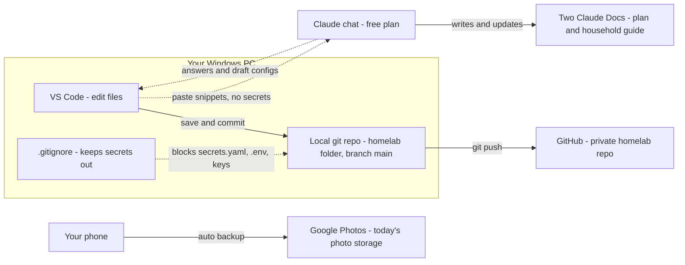

# Homelab flow diagrams

Two diagrams: what you have working today, and how it fits into the full homelab plan. Green boxes in the second diagram are things you already have.

## 1. Your flow today

You edit files in VS Code on your Windows PC and commit them to a local git repo. A push sends them to a private GitHub repo. A `.gitignore` keeps secrets out. You use Claude chat for questions and drafts, and Google Photos still holds your photos (assumed from your goal of replacing it).

Key points:

- Your repo history lives in two places today: the local folder and GitHub.
- Nothing runs at home yet, so there is no server, no backup drive and no local photo storage.
- Claude chat has no direct connection to your files. Anything it sees, you paste in.

## 2. How it fits into the full plan

Once the server runs, Forgejo becomes the main home for your repo, and GitHub stays as the offsite mirror. Photos move from Google Photos to Immich on your own hard drive. Jellyfin will serve movies, shows and music from a separate media drive to your TVs over the home network, once you have a library. Option A (one box) is the chosen design. Home Assistant talks to your sensors through the two USB radio sticks, and the UPS keeps the router and server running through short power cuts.

```mermaid
flowchart TB
    subgraph OUT["Outside your home"]
        NET["Internet via ISP modem"]
        GH["GitHub - private repo, offsite mirror"]
        CLOUD["Encrypted cloud backup - optional"]
    end

    subgraph HOME["Your home network"]
        UPS["UPS battery backup"]
        ROUTER["Router and Wi-Fi - hands DNS to Pi-hole"]

        subgraph SERVER["Proxmox server - one mini PC"]
            PIHOLE["Pi-hole - ad blocking"]
            HA["Home Assistant - smart home hub"]
            IMMICH["Immich - photos and video"]
            FORGEJO["Forgejo - git server"]
            JELLYFIN["Jellyfin - movies, shows, music"]
            SSD["NVMe SSD - Proxmox and VMs"]
            HDD["4 TB hard drive - photo library"]
            MEDIA["Media drive - added when a library exists"]
            ZB["Zigbee stick"]
            ZW["Z-Wave stick"]
        end

        BACKUP["External USB backup drive"]
        PC["Windows PC - VS Code and Git"]
        PHONE["Phones with Immich app"]
        SENSORS["Zigbee and Z-Wave sensors"]
        TABLET["Control tablet"]
        TV["Samsung Smart TV"]
        INFO["Info display"]
    end

    NET --- ROUTER
    ROUTER -->|"Ethernet cable"| SERVER
    ROUTER -->|"DNS lookups"| PIHOLE

    PC -->|"git push - main home"| FORGEJO
    FORGEJO -->|"automatic mirror"| GH
    PC ==>|"git push - works today"| GH

    PHONE -->|"auto-upload on home Wi-Fi only"| IMMICH
    IMMICH --> HDD
    TV -->|"stream over home network only"| JELLYFIN
    JELLYFIN --> MEDIA
    MEDIA -.->|"optional copy"| BACKUP

    SENSORS -.->|"radio"| ZB
    SENSORS -.->|"radio"| ZW
    ZB --> HA
    ZW --> HA
    TABLET -->|"dashboard"| HA
    INFO -->|"dashboard"| HA

    HDD -->|"backup copy"| BACKUP
    HDD -->|"encrypted copy"| CLOUD

    UPS -.->|"power"| NET
    UPS -.->|"power"| ROUTER
    UPS -.->|"power and shutdown signal"| SERVER

    classDef have fill:#E1F5EE,stroke:#0F6E56,color:#04342C
    class PC,GH have
```

Legend:

- Solid arrow: data or network traffic.
- Thick arrow: the git push you can already do today.
- Dotted arrow: radio links, power and optional copies.
- Green boxes: things you already have set up.

## 3. What changes when the server arrives

| Area | Today | After the server |
|---|---|---|
| Main git home | GitHub | Forgejo on the server |
| GitHub's role | Primary copy | Offsite mirror |
| Photos | Google Photos | Immich on your own hard drive, with a backup drive |
| Streaming services | Netflix, Hulu, HBO Max, Prime, Disney+, YouTube, YouTube TV, Paramount in their own apps | Unchanged. They stay separate from Jellyfin. Test them after the Pi-hole switch |
| Media | Not set up here | Jellyfin on a separate media drive, added once a library exists, local network only |
| Smart home | None | Home Assistant with Zigbee and Z-Wave sticks |
| Ad blocking | None | Pi-hole, set as your network's DNS |
| Power protection | None | UPS for the server, router and modem |
| Displays | None | A control tablet and an info display |
| Claude | Chat with copy and paste | Same, plus your configs already in git to paste from |

Moving to Forgejo is just adding a second remote to your existing repo and pushing. Your history comes with it.
